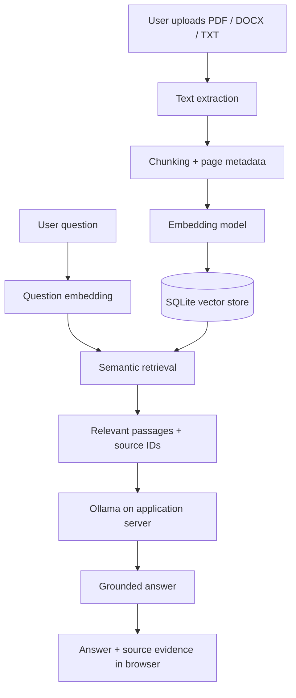

# DocuMind — Enterprise Document Intelligence

> Ask questions about your documents and inspect the evidence behind every answer.

**Live demo:** Not deployed yet. A public browser link will be added here after the application is deployed and tested.

DocuMind is a Retrieval-Augmented Generation (RAG) application that helps users explore PDF, DOCX and TXT documents using natural-language questions. It retrieves relevant passages before generating an answer and displays the source evidence so users can verify the response.

## Try the intended experience

1. Open the hosted application in a browser.
2. Upload a PDF, Word document or text file (up to **20 MB per file**).
3. Ask a question in natural language.
4. Review the response and inspect the retrieved source passages and page references.

**Visitors do not install Python, Docker, Linux or Ollama.** In the hosted version, the application and Ollama model run on the server. The visitor only needs a modern web browser.

> The public demo is not live yet. The repository contains deployment configuration, but a working public URL must not be assumed until deployment and end-to-end testing are complete.

## Highlights

- PDF, DOCX and TXT ingestion
- 20 MB per-file upload limit
- Text chunking with page and filename metadata
- Local semantic embeddings using Sentence Transformers
- Similarity-based retrieval of relevant passages
- Ollama-hosted open-weight language model for answer generation
- Evidence-only fallback when generation is unavailable
- Source passage display to support answer verification
- Streamlit browser interface
- Docker Compose setup for the application and Ollama

## Product preview

The application provides a document workspace, upload controls, indexed-document list, question interface, answer panel and expandable source evidence. Add screenshots here after the UI has been run and captured:

| Workspace | Evidence-backed answer |
|---|---|
| *Screenshot to be added* | *Screenshot to be added* |

## How it works

The uploaded document is the evidence source. The language model is used to formulate an answer from retrieved passages; it should not be treated as an independent source of truth.

## Technology

| Area | Technology |
|---|---|
| User interface | Streamlit |
| Language | Python |
| Document parsing | pypdf, python-docx |
| Embeddings | Sentence Transformers |
| Retrieval/storage | SQLite and vector similarity |
| Language model serving | Ollama |
| Containerization | Docker Compose |

## Deployment model

The public-facing experience is browser-only. The server operator provisions the host, installs Docker, downloads the Ollama model and runs the application. Recruiters and other visitors do not perform those setup steps.

Ollama avoids dependence on a third-party per-request API quota, but it does **not** make hosting free: the host still needs sufficient memory, CPU and persistent disk. See [Deployment guide](docs/DEPLOYMENT.md) for the operator setup.

## Responsible demo use and limitations

- Use public or fictional documents in a portfolio demo. Do not upload confidential company or personal records.
- Answers are grounded using retrieved passages and source references, but grounding safeguards are not a mathematical guarantee against hallucinations. Verify the cited text for important decisions.
- Scanned/image-only PDF OCR is not included unless separately configured.
- This portfolio application is not a production multi-tenant records platform. Authentication, tenant-level authorization, encryption-at-rest, audit logging and abuse controls require additional hardening before real enterprise use.
- Persistent storage and backups must be configured by the host if uploaded documents need to survive server replacement.

## Repository documentation

- [Architecture](docs/ARCHITECTURE.md)
- [Deployment and operator setup](docs/DEPLOYMENT.md)
- [Interview preparation](docs/INTERVIEW_PREPARATION.md)

## Local development

For contributors who want to run the project on their own machine, see [Deployment guide](docs/DEPLOYMENT.md). Recruiters using a deployed demo do not need to follow those instructions.

## License

MIT — see [LICENSE](LICENSE).
