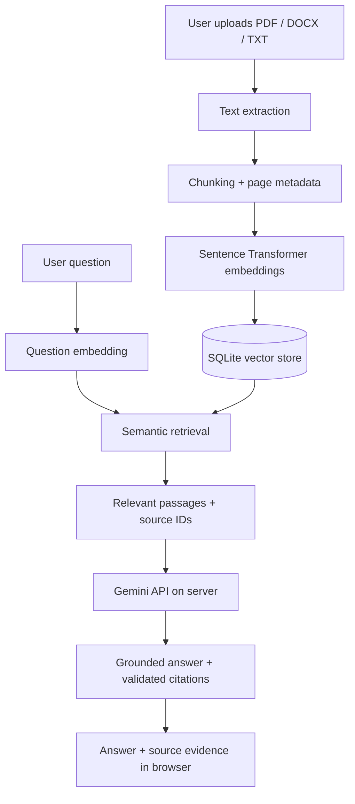

# DocuMind — Enterprise Document Intelligence

> Ask questions about your documents and inspect the evidence behind every answer.

**Live demo:** Not deployed yet. The public browser link will be added here after deployment and end-to-end testing.

DocuMind is a Retrieval-Augmented Generation (RAG) application for exploring PDF, DOCX and TXT documents using natural-language questions. It retrieves relevant passages before generating an answer and displays the source evidence so users can verify the response.

## Try the intended experience

1. Open the hosted application in a browser.
2. Upload a PDF, Word document or text file (up to **20 MB per file**).
3. Ask a question in natural language.
4. Review the response and inspect the retrieved source passages and page references.

**Visitors do not install Python, Docker, Linux, Ollama or configure an API key.** The application and Gemini connection run server-side; visitors only need a modern web browser.

## Highlights

- PDF, DOCX and TXT ingestion
- 20 MB per-file upload limit
- Text chunking with page and filename metadata
- Semantic embeddings using Sentence Transformers
- Similarity-based retrieval of relevant passages
- Gemini API answer generation using retrieved evidence
- Citation validation and evidence-only fallback
- Expandable source passages for answer verification
- Streamlit browser interface
- Optional Ollama mode for local/Docker deployments

## How it works

The uploaded documents are the evidence source. Gemini is instructed to formulate an answer only from retrieved passages; it should not be treated as an independent source of truth.

## Technology

| Area | Technology |
|---|---|
| User interface | Streamlit |
| Language | Python |
| Document parsing | pypdf, python-docx |
| Embeddings | Sentence Transformers |
| Retrieval/storage | SQLite and vector similarity |
| Answer generation | Google Gemini API |
| Optional local inference | Ollama |
| CI | GitHub Actions |

## Free deployment

The intended public demo uses **Streamlit Community Cloud** for hosting and the **Gemini API free tier** for answer generation. This avoids a paid VM and avoids running Ollama in the hosted environment. Free API access has model-specific rate limits and can change; if the quota is reached, DocuMind falls back to displaying the retrieved evidence.

The Gemini key is stored in Streamlit's server-side Secrets settings. It is never committed to this repository or sent to the recruiter's browser. See [Free deployment instructions](docs/DEPLOYMENT.md).

## Product preview

The application provides a document workspace, upload controls, indexed-document list, question interface, answer panel and expandable source evidence. Screenshots will be added after the hosted app has been run and captured.

## Responsible demo use and limitations

- Use public or fictional documents in a portfolio demo. Do not upload confidential company or personal records.
- Google's Gemini API free tier may use submitted prompts and responses to improve its products. Do not send confidential, personal or proprietary documents through the free-tier API. See [Gemini API pricing and data-use notes](https://ai.google.dev/gemini-api/docs/pricing).
- Free hosting has resource limits and may hibernate apps after inactivity. First load and model initialization may take time.
- Gemini free-tier quotas are limited and may change. A quota or service error triggers an evidence-only fallback.
- Answers are grounded using retrieved passages and source references, but this is not a mathematical guarantee against hallucinations. Verify cited text for important decisions.
- Scanned/image-only PDF OCR is not included.
- This portfolio demo is not a production multi-tenant records platform. Authentication, tenant-level authorization, encryption-at-rest, audit logging and abuse controls require additional hardening.
- Hosted local storage may be ephemeral. Do not rely on uploaded documents persisting after app restarts or redeployments.

## Repository documentation

- [Architecture](docs/ARCHITECTURE.md)
- [Deployment and operator setup](docs/DEPLOYMENT.md)
- [Interview preparation](docs/INTERVIEW_PREPARATION.md)

## Local development

For contributors who want to run the project locally, see [Deployment guide](docs/DEPLOYMENT.md). Recruiters using the hosted demo do not need to follow those instructions.

## License

MIT — see [LICENSE](LICENSE).
