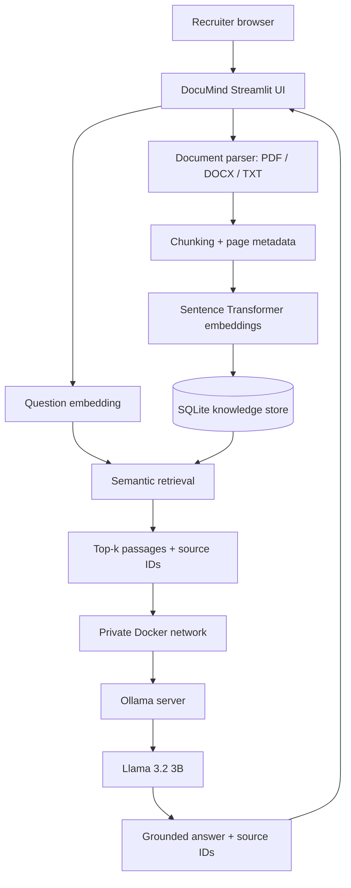

# DocuMind — Enterprise Document Intelligence Assistant

A browser-based Retrieval-Augmented Generation (RAG) application for asking questions across PDF, DOCX and TXT documents. The portfolio deployment uses **Ollama running on the application server**, so visitors need only a browser and do not need to install an LLM or provide an API key.


## Recruiter experience

1. Open the deployed DocuMind URL in a browser.
2. Upload a PDF, Word document or text file (up to **20 MB per file**).
3. Ask a question in plain English.
4. Read the response and inspect the source file, page number and retrieved evidence.

No local Ollama installation, Python setup, or Gemini API key is required for visitors. Ollama and the model run on the host server.

## Why server-hosted Ollama?

A free third-party API can impose request and token quotas. DocuMind therefore prefers a self-hosted open model (`llama3.2:3b`) running in a dedicated Ollama Docker container. The app calls Ollama over a private Docker network. The Ollama port is not exposed publicly.

**Important trade-off:** the software and model can be used without a per-request Gemini API key, but hosting the server costs money and requires adequate RAM/CPU. A small 3B model is suitable for a portfolio demo, not a guarantee of enterprise-grade reasoning.

## Features

- PDF, DOCX and TXT document ingestion
- 20 MB maximum per file
- Page-aware chunking and citations
- Local semantic embeddings (`all-MiniLM-L6-v2`)
- SQLite-backed document/chunk store, isolated by browser session in the demo
- Semantic retrieval with configurable top-k and similarity threshold
- Ollama-first grounded answer generation
- Optional Gemini fallback (not required)
- Evidence-only fallback if model generation is unavailable or citations are invalid
- Polished responsive Streamlit interface
- Docker Compose deployment with automatic Ollama model pull
- Pytest suite and GitHub Actions workflow

## Architecture



## Run locally with Docker (recommended)

Requirements:
- Docker Desktop or Docker Engine with Docker Compose
- At least **8 GB RAM** available to Docker; **12–16 GB is recommended** for a smoother experience
- Internet access on first launch to download the container images, embedding model and LLM

```bash
git clone https://github.com/YOUR_USERNAME/enterprise-document-intelligence-assistant.git
cd enterprise-document-intelligence-assistant
cp .env.example .env
docker compose up --build
```

On Windows PowerShell, use `Copy-Item .env.example .env` instead of `cp` if needed.

The first startup automatically downloads `llama3.2:3b`. This may take a few minutes and several GB of disk space. Then open:

`http://localhost:8501`

The recruiter does not perform these setup steps when using the deployed public URL; the project owner performs them once on the server.

### Change the model

Set `OLLAMA_MODEL` in `.env` and restart the stack. For example, a larger model may improve answer quality but needs more memory and compute. The default 3B model is selected to keep hosting requirements more manageable.

## Deploy a public demo

Use a Linux VPS or cloud VM that supports Docker. Do **not** assume a free Streamlit-only hosting tier can run Ollama reliably.

Suggested starting point:
- 4 vCPU
- 8 GB RAM minimum; 16 GB preferred
- 30–50 GB SSD for Docker images, model files and temporary data
- HTTPS reverse proxy (Caddy or Nginx) in front of port 8501
- Firewall: expose only SSH and HTTPS; do not expose Ollama port 11434

Deployment outline:
1. Provision the VM and install Docker Engine + Compose.
2. Clone this repository onto the VM.
3. Configure `.env` with `OLLAMA_ENABLED=true`, `OLLAMA_BASE_URL=http://ollama:11434`, and `OLLAMA_MODEL=llama3.2:3b`.
4. Run `docker compose up -d --build`.
5. Configure a domain and HTTPS reverse proxy to the app on port 8501.
6. Add the public HTTPS URL to the GitHub README and resume.
7. Test with the included fictional handbook and several questions before sharing.

The Compose stack keeps Ollama on an internal Docker network and automatically pulls the model into a persistent volume. The app container has a 6 GB memory limit; adjust it and the VM size if needed.

## Optional Gemini fallback

Ollama is the primary answer engine. If desired, add a server-side `GEMINI_API_KEY` and `GEMINI_MODEL` to `.env` to enable Gemini only when Ollama is unavailable. Never commit real API keys. Do not put keys in frontend code.

## Run without Docker (local development)

1. Install Python 3.10–3.12 and Ollama.
2. Pull the model and start Ollama:
   ```bash
   ollama pull llama3.2:3b
   ollama serve
   ```
3. Create a virtual environment and install dependencies:
   ```bash
   python -m venv .venv
   # Windows PowerShell
   .venv\Scripts\Activate.ps1
   # macOS/Linux
   source .venv/bin/activate
   pip install -r requirements.txt
   ```
4. Set `OLLAMA_ENABLED=true` and `OLLAMA_BASE_URL=http://localhost:11434` in `.env`.
5. Start the UI:
   ```bash
   streamlit run app.py
   ```

## Example

Upload `data/sample_documents/employee_handbook_sample.txt`, index it, and ask:

`How many days of annual leave are provided?`

The sample handbook is fictional and intended for demonstration.

## Grounding and limitations

- The model is instructed to answer only from retrieved passages and cite source IDs. The application validates that cited IDs exist in the retrieved context; this is a safeguard, not a mathematical guarantee against hallucinations.
- Inspect source passages for important decisions. If retrieval finds no sufficiently relevant evidence, the app abstains.
- OCR for scanned/image-only PDFs is not included.
- The public demo is not a production multi-tenant records platform. It uses session-isolated SQLite files but does not implement full authentication, durable tenant authorization, encryption-at-rest, or comprehensive abuse protection.
- Use synthetic or public documents only. Never upload confidential company records to a public portfolio demo.
- Uploaded documents may be lost if the host deletes its local disk. Use persistent server storage and backups for longer-lived deployments.
- Public hosting incurs server costs even though Ollama itself does not charge a per-request API fee.

## Tests

```bash
pytest -q
```

## Interview talking points

- Why RAG retrieves evidence before text generation
- How embeddings and cosine similarity work
- Why chunk overlap and page metadata matter
- How the system abstains when evidence is weak
- Why a self-hosted LLM removes third-party API quota dependence but shifts cost to infrastructure
- How to validate retrieval quality and grounded answer quality

## License

MIT. See `LICENSE`.
